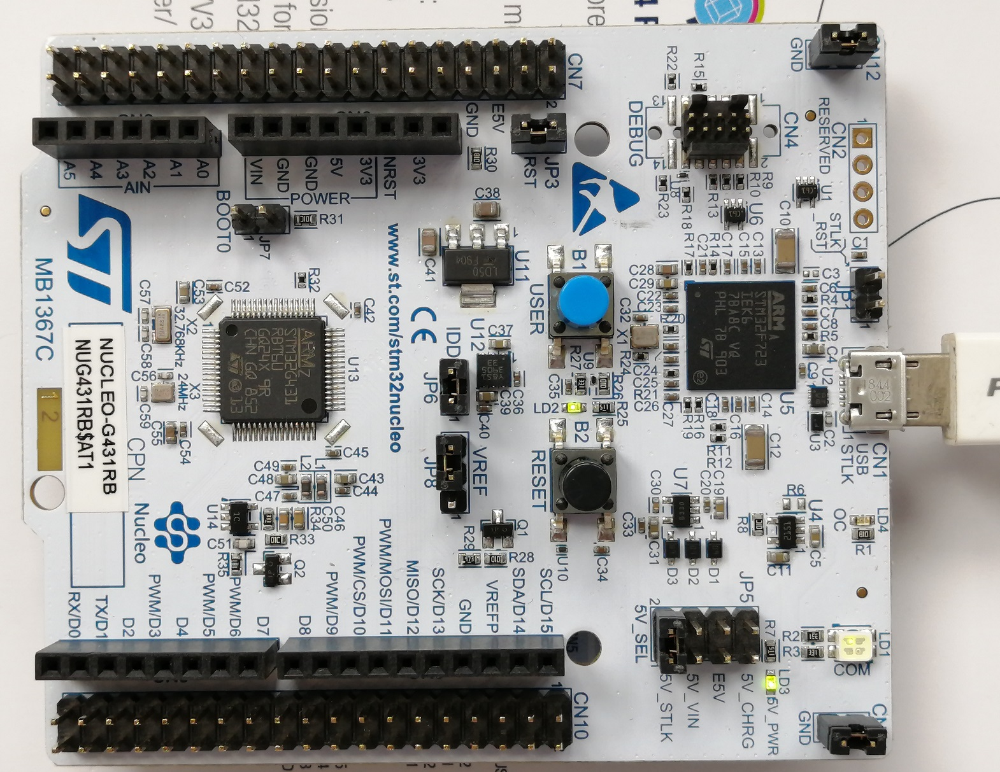

# nucleo-g431 - STM32G431RBT6 Nucleo-64 development projects

Bare-metal projects for the **nucleo-g431** board (Nucleo-64 with
STM32G431RBT6), built with **CMake/Ninja** (Pico-style), debugged and
flashed through the onboard **ST-Link** over **SWD**, with `printf()`
streamed out **USART2 (PA2/PA3)** at 115200 baud - the ST-LINK
**virtual COM port (VCP)** is the console.

## Board facts

- MCU: STM32G431RBT6 (Cortex-M4F @ up to 170 MHz, 128 KB flash, 32 KB SRAM
  + 10 KB CCM-SRAM) - **runs at its 170 MHz maximum**
- Clock: **HSI 16 MHz -> PLL -> 170 MHz** (M=4/N=85/R=2; regulator
  Range 1 **BOOST** is required above 150 MHz; AHB=APB1=APB2=170;
  flash latency 4 wait states). The Nucleo-64 has no HSE crystal fitted -
  the 8 MHz ST-LINK MCO only reaches PF0 through solder bridges, so the
  internal HSI is the reliable source.
- LED: **LD2=PA5** (green) - **high-active** (pin SET = on)
- Button: USER B1 = PC13, pressed = high
- Console: **USART2 PA2 (TX) / PA3 (RX)**, 115200 8-N-1 - ST-LINK VCP
- Debug: onboard ST-Link over SWD; probe-rs auto-detects it
  (`--chip STM32G431RB`)

## Projects (`app/`)

| Project           | What it does                                    |
| ----------------- | ----------------------------------------------- |
| `app/blink_hello` | LD2 (PA5) blink + B1 button check + ADC1 internal-channel report (temp/VREFINT/VBAT) |
| `app/dhry_170m`   | Dhrystone 2.1 benchmark @ 170 MHz               |
| `app/coremark_170m` | CoreMark 1.0.1 benchmark @ 170 MHz            |
| `app/cordic_test` | sine benchmark: HW CORDIC vs CMSIS DSP vs FPU sinf vs soft-float vs double (two builds: hard + soft ABI) |
| `app/fmac_test`  | FIR filter benchmark: HW FMAC vs CPU q1.15 vs FPU float vs soft-float vs double (two builds: hard + soft ABI) |
| `app/sx395hvga40p-01-v01` | ILI9488 3.5" 320x480 SPI LCD demo (soft bit-bang + HW SPI2 with DMA) - panel not connected yet |

## Notes

- The board layer lives in `board/` (clock init, LED, USART2 printf,
  startup, linker script) and is attached to projects by
  `cmake/stm32g431_board.cmake` (`stm32g431_apply_board()`).
- `flash-targets.cmake` programs the chip with probe-rs
  (`--chip STM32G431RB`) or OpenOCD (`openocd_stm32g431rb.cfg`).
- Board photographs: [`board_images/`](board_images) (referenced above).
